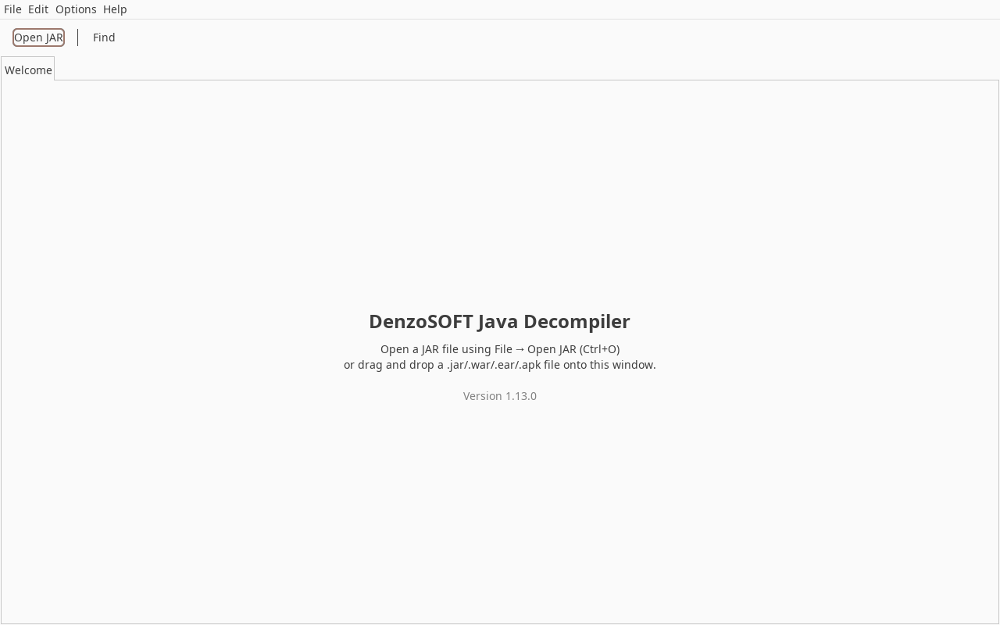
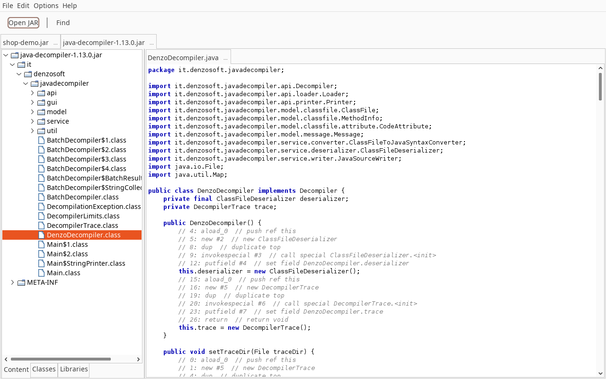
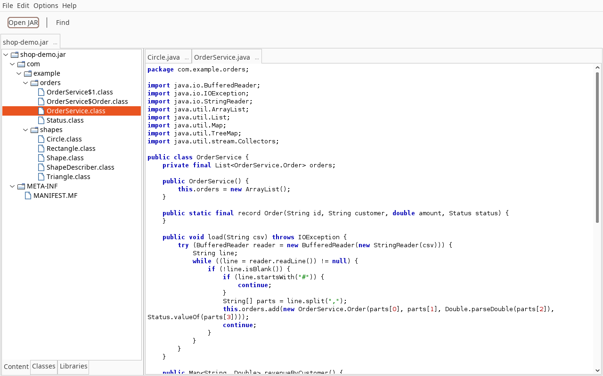
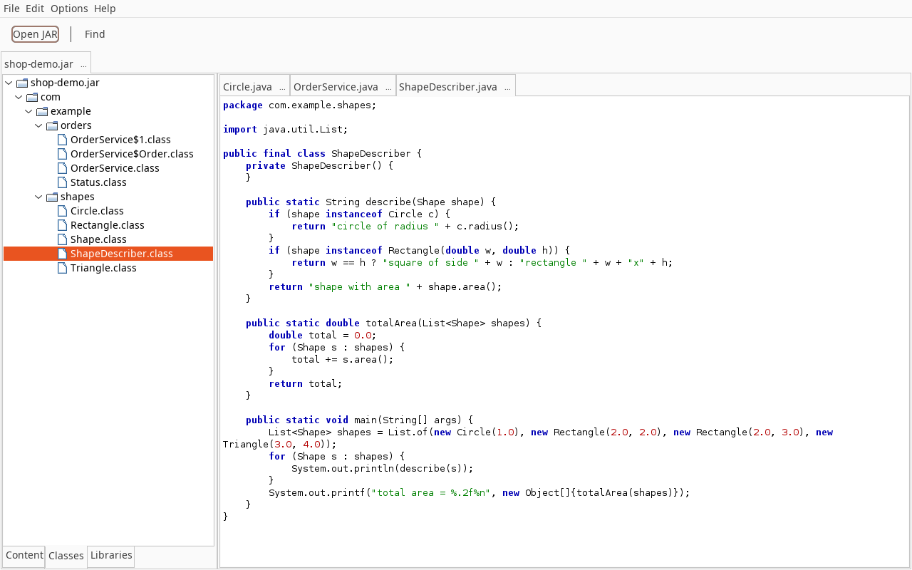
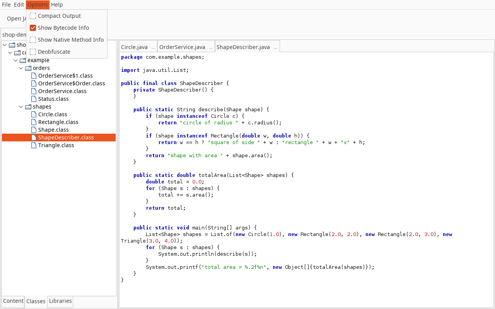

# DenzoSOFT Java Decompiler v1.13.0 — User Manual

This manual covers installing and running the DenzoSOFT Java Decompiler: the graphical interface, the
command line, the output options, the library and class-inspection APIs, and how to read and judge the
code it produces. Every example output in this manual was produced with the v1.13.0 JAR.

## Contents

1. [Introduction](#1-introduction)
2. [Installation and requirements](#2-installation-and-requirements)
3. [Quick start](#3-quick-start)
4. [Graphical interface](#4-graphical-interface)
5. [Command line](#5-command-line)
6. [Output options explained](#6-output-options-explained)
7. [Library API](#7-library-api)
8. [Class inspection API](#8-class-inspection-api)
9. [Reading decompiled output](#9-reading-decompiled-output)
10. [Known limitations](#10-known-limitations)
11. [Troubleshooting and FAQ](#11-troubleshooting-and-faq)
12. [Reporting bugs](#12-reporting-bugs)

---

## 1. Introduction

DenzoSOFT Java Decompiler reconstructs Java source code from compiled `.class` files. It ships as a
single JAR that works three ways:

- a **Swing GUI** for browsing archives (`.jar`, `.war`, `.ear`, `.apk`) and reading classes,
- a **command line** for one class at a time or for parallel batch runs over a whole archive or directory,
- a **library API** (`DenzoDecompiler`, `Loader`, `Printer`), plus a read-only, Javassist-like
  **class inspection API** (`ClassPool`, `CtClass`, ...).

| Property | Value |
|---|---|
| Class file versions read | Java 1.0 to Java 25 (major versions 45 to 69). Newer class files are read on a best-effort basis: a class that uses no new construct decompiles; an unknown constant-pool entry is still an error. |
| Runtime required | Java 6 or later (the JAR is compiled to Java 6 bytecode) |
| Dependencies | None. Only JDK classes are used. |
| License | GPLv3 |
| Lineage | Based on the architecture of JD-Core by Emmanuel Dupuy, extended as a clean-room implementation in `it.denzosoft.javadecompiler` |

Language features it reconstructs include generics, enums, annotations, lambdas and method references,
string switch, try-with-resources, records, sealed types, switch expressions, pattern matching for
`instanceof` and `switch` (type patterns, `when` guards, `case null`, record deconstruction), unnamed
patterns, `module-info` and Java 25 flexible constructor bodies. The README has the full feature list.

**What a decompiler cannot give back.** Comments, formatting, `@Override` and other source-retention
annotations are not stored in class files. Local variable names exist only if the class was compiled
with `-g` (see [section 9.3](#93-how-debug-information-affects-the-output)). And the output is a
reconstruction, not the original: it usually recompiles, but not always, and in some known shapes it
compiles and means something different (see [section 10](#10-known-limitations)). Read critical code
against the bytecode before you rely on it.

---

## 2. Installation and requirements

### 2.1 Download a release

Prebuilt JARs are attached to each GitHub release:

<https://github.com/DenzoSOFTHub/DenzoSOFT-JavaDecompiler/releases>

Download `java-decompiler-1.13.0.jar`. You do not need to install it: any Java 6 or later runtime
can run it with `java -jar`.

### 2.2 Build from source

The project's source and target level is Java 1.6, and current javac versions reject
`-source 6` ("Source option 6 is no longer supported"). **Build with a JDK 8:**

```bash
git clone https://github.com/DenzoSOFTHub/DenzoSOFT-JavaDecompiler.git
cd DenzoSOFT-JavaDecompiler
JAVA_HOME=/path/to/jdk8 mvn clean package
```

The JAR is written to `target/java-decompiler-1.13.0.jar`. A plain `mvn clean package` fails if your
default JDK is 9 or newer.

### 2.3 Check the installation

```bash
java -jar java-decompiler-1.13.0.jar --version
```

```
DenzoSOFT Java Decompiler v1.13.0
Supports Java 1.0 through Java 25
```

> The built-in usage text and parts of the older documentation call the JAR
> `denzosoft-decompiler.jar`. That is the same program; use whatever file name you downloaded.
> This manual uses `java-decompiler-1.13.0.jar` throughout.

---

## 3. Quick start

```bash
# Open the GUI (no arguments)
java -jar java-decompiler-1.13.0.jar

# Open the GUI with an archive already loaded
java -jar java-decompiler-1.13.0.jar --gui myapp.jar

# Print one class to the terminal
java -jar java-decompiler-1.13.0.jar target/classes/com/example/MyClass.class

# Print one class from inside a JAR and save it
java -jar java-decompiler-1.13.0.jar myapp.jar com/example/MyClass > MyClass.java

# Decompile a whole JAR into a source tree
java -jar java-decompiler-1.13.0.jar --batch myapp.jar decompiled/
```

---

## 4. Graphical interface

Start the GUI with no arguments, or with `--gui` followed by zero or more archives:

```bash
java -jar java-decompiler-1.13.0.jar
java -jar java-decompiler-1.13.0.jar --gui app.jar web.war
```

Arguments after `--gui` that do not end in `.jar`, `.war`, `.ear` or `.apk` are ignored. Output
flags such as `--compact` or `--show-bytecode` are **not** passed to the GUI; use its *Options*
menu instead. The window uses the platform's native look and feel.

### 4.1 Welcome screen



With no archive open, the window shows a *Welcome* tab. It is removed when you open the first
archive.

### 4.2 Opening archives

There are three ways to open an archive:

| Method | Details |
|---|---|
| *File > Open JAR...* or **Ctrl+O** | File chooser filtered to *Archives (\*.jar, \*.war, \*.ear, \*.apk)*. You can select several files at once. |
| Toolbar button **Open JAR** | Same as the menu item. |
| Drag and drop | Drop one or more files onto the window. Files ending in `.jar`, `.war`, `.ear` or `.apk` (any case) are opened; anything else, including loose `.class` files, is silently ignored. |

The GUI opens archives only. To read a loose `.class` file, use the command line
([section 5.2](#52-decompile-a-single-class-file)), or pack the directory into a JAR first
(`jar cf classes.jar -C target/classes .`).

Each archive opens in its own top-level tab, named after the file and closed with its **x** button.
Several archives can be open at once:



### 4.3 The archive tab



An archive tab is split in two. The left side is a navigation tree. Its tabs are at the bottom of the
panel. The right side holds one editor tab per opened entry. Drag the divider to resize the two
sides, or use its one-touch arrows to collapse a side.

**Navigation tabs**

| Tab | Shows |
|---|---|
| **Content** | Every file entry in the archive, as stored: classes, resources, manifests, nested JARs. Folders sort first, then files, alphabetically (ignoring case). |
| **Classes** | Only `.class` files, without resources. Entries under `WEB-INF/lib/` and `BOOT-INF/lib/` (and `lib/` in EAR and APK files) are excluded. The `WEB-INF/classes/` and `BOOT-INF/classes/` prefixes are hidden, so WAR and Spring Boot classes appear under their packages. |
| **DEX Classes** | Replaces *Classes* for an `.apk` whose DEX files can be parsed. Lists the class names found in each `classes*.dex`. See [4.6](#46-archive-types). |
| **Libraries** | Every `.jar` entry in the archive, wherever it is stored (for example `WEB-INF/lib/*.jar`, `BOOT-INF/lib/*.jar`). |



**Opening entries.** Double-click a leaf in any tree:

| Entry | Result |
|---|---|
| `.class` file | Decompiled into a new editor tab titled `Name.java`, with syntax highlighting. |
| Nested `.jar` | Extracted to a temporary file (deleted when the program exits) and opened as a new **top-level** archive tab. Its tab title is the temporary file's name (`denzosoft_nested_<number>.jar`), not the original entry name. |
| Any other file | Shown as UTF-8 text, without highlighting. Binary resources show as unreadable characters. |

Double-clicking an entry that is already open selects its existing tab and does **not** decompile it
again. Nested classes (`Outer$Inner.class`) are listed too, but the decompiler already writes them
inside their outer class, so open the outer class instead.

If a class cannot be decompiled at all, its tab contains a single line
`// Error decompiling <entry>: <message>`.

**Editor tabs** are read-only. Each has its own **x** close button. Highlighting colours: keywords
bold blue, strings and characters green, comments grey italic, annotations teal, numbers red.

### 4.4 Menus and toolbar

| Menu | Item | Shortcut | Action |
|---|---|---|---|
| **File** (Alt+F) | Open JAR... | Ctrl+O | Open one or more archives |
| | Close Tab | Ctrl+W | Close the selected **archive** tab and release the archive file |
| | Exit | | Quit the application |
| **Edit** (Alt+E) | Find... | Ctrl+F | Search the selected editor tab (see below) |
| | Copy | Ctrl+C | Copy the selection in the selected editor tab |
| | Select All | Ctrl+A | Select the whole text of the selected editor tab |
| **Options** (Alt+P) | Compact Output | | Has no effect in v1.13.0 (see below) |
| | Show Bytecode Info | | Show each statement's JVM instructions as comments |
| | Show Native Method Info | | Add the JNI function name and C parameter types to `native` methods |
| | Deobfuscate | | Sanitize illegal identifiers and annotate obfuscation patterns |
| **Help** (Alt+H) | About | | Version, newest supported Java version, license |

The toolbar has two buttons: **Open JAR** (same as Ctrl+O) and **Find** (same as Ctrl+F).

The shortcuts use the Control key on every platform, including macOS.

**Find.** It opens a dialog that asks for the text to look for. The search ignores case. It selects the
**first** occurrence in the current editor tab and scrolls to it, or reports *Text not found*. Each
Find starts again from the top of the tab, so running it twice with the same text selects the same
occurrence. To step through all matches, select all (Ctrl+A), copy, and search in a text editor. If
no editor tab is open, Find reports *No source tab is open.*

### 4.5 Options



The four items in the *Options* menu are checkboxes. All start unchecked, and the program does not
save them between sessions. Section 6 explains what each one does.

**When options take effect.** The options are read when a class is decompiled, which is when you
open its editor tab. Changing an option does **not** refresh tabs that are already open, and
double-clicking an open class only selects its tab. To see a class with new options, close its editor
tab and open the class again.

**Compact Output has no effect (known issue, BUG-2026-0204).** The GUI always shows the dense layout,
without the blank lines used to line statements up with the original source. Checking *Compact
Output* changes nothing. For line-aligned output, use the command line (default mode).

### 4.6 Archive types

| Type | How the GUI treats it |
|---|---|
| `.jar` | Classes and resources as stored. |
| Spring Boot fat JAR | Application classes under `BOOT-INF/classes/` appear under their packages in *Classes*. The bundled libraries (`BOOT-INF/lib/*.jar`) appear in *Libraries*. Open a library to browse it in its own tab. |
| `.war` | Same treatment as Spring Boot, with `WEB-INF/classes/` and `WEB-INF/lib/`. |
| `.ear` | `lib/` entries are treated as libraries. Nested `.jar` modules open in their own tab. Nested `.war` modules cannot be opened this way: double-clicking one shows its raw bytes as text. Extract it and open it separately. |
| `.apk` | Android DEX bytecode is **not decompiled**. *DEX Classes* lists class names only, and double-clicking them does nothing. Convert the APK with an external tool such as dex2jar, then open the resulting JAR. |

> **Nested classes in WAR and Spring Boot archives.** For classes stored under `WEB-INF/classes/` or
> `BOOT-INF/classes/`, nested and inner classes (records, interfaces and other types declared inside
> a class) can be **missing from the output without any warning**. The same happens in batch mode
> ([5.4](#54-batch-mode)). To get complete output, extract the classes directory and decompile it as
> a plain directory (or re-pack it as a JAR):
>
> ```bash
> mkdir app && cd app && jar xf ../app.war && cd ..
> java -jar java-decompiler-1.13.0.jar --batch app/WEB-INF/classes decompiled/
> ```

---

## 5. Command line

### 5.1 Synopsis

```
java -jar java-decompiler-1.13.0.jar                                   GUI
java -jar java-decompiler-1.13.0.jar --gui [archive ...]               GUI with archives
java -jar java-decompiler-1.13.0.jar [options] <file.class>            one class to stdout
java -jar java-decompiler-1.13.0.jar [options] <file.jar> <class>      one class from a JAR to stdout
java -jar java-decompiler-1.13.0.jar [options] --batch <input> <out>   whole archive or directory
java -jar java-decompiler-1.13.0.jar [options] --trace <dir> <file.class>
java -jar java-decompiler-1.13.0.jar [options] --trace <dir> <file.jar> <class>
java -jar java-decompiler-1.13.0.jar --version | -v
```

**Output options** can be placed anywhere on the command line and combined freely:

| Option | Effect |
|---|---|
| `--compact` | No line alignment: omit the blank lines that keep statements on their original line numbers |
| `--align-lines` | Line alignment (already the default). If both flags are given, the last one wins. |
| `--show-bytecode` | Before each statement, print the JVM instructions it came from as comments |
| `--show-native-info` | Append the JNI function name and C parameter types to each `native` method |
| `--deobfuscate` | Sanitize illegal identifiers and annotate known obfuscation patterns |

The options apply to single-class, JAR, `--batch` and `--trace` runs. Section 6 shows what each one
produces.

There is no `--help` flag: unknown words are treated as file names
(`Error: unsupported file type. Use .class or .jar files.`). The usage text is printed when the
command line holds only options and no file.

### 5.2 Decompile a single class file

```bash
java -jar java-decompiler-1.13.0.jar target/classes/demo/Counter.class
java -jar java-decompiler-1.13.0.jar --compact Counter.class > Counter.java
```

The source is printed to standard output. Nested and inner classes are loaded from `Outer$Inner.class`
files **in the same directory** and written inside the outer class. If those files are missing, the
nested types are left out of the output without a warning. Always decompile from the full output
directory, not from a copied single file.

### 5.3 Decompile one class from a JAR

```bash
java -jar java-decompiler-1.13.0.jar myapp.jar com/example/MyClass
java -jar java-decompiler-1.13.0.jar myapp.jar com.example.MyClass      # dots work too
```

Give the class name without `.class`, separated by `/` or `.`. All classes in the JAR can be loaded,
so nested classes are found automatically. Only `.jar` files are accepted here. To read a class from a
`.war`, `.ear` or `.apk`, use the GUI or `--batch`.

If the class is not in the JAR, a diagnostic report is printed to standard error and the exit code is 1:

```
=== DenzoSOFT Decompiler Diagnostic Report ===
Class: demo/Nope
Pipeline stage: deserializer
Error: Deserialization failed for class 'demo/Nope': Cannot load class: demo/Nope
Root cause: java.lang.IllegalArgumentException: Cannot load class: demo/Nope
...
```

### 5.4 Batch mode

```bash
java -jar java-decompiler-1.13.0.jar --batch myapp.jar decompiled/
java -jar java-decompiler-1.13.0.jar --batch target/classes decompiled/
java -jar java-decompiler-1.13.0.jar --compact --show-native-info --batch lib.jar out/
```

The input can be a directory of `.class` files (searched recursively) or a `.jar`, `.war`, `.ear` or
`.apk` file. The output directory is created if needed. Each top-level class is written to
`<out>/<package path>/<Name>.java` in UTF-8. Existing files are overwritten. Classes are decompiled in
parallel, one thread per available CPU core.

A summary is printed at the end (real run over a two-class JAR):

```
Batch decompilation complete:
  Total classes: 2
  Succeeded:     2
  Errors:        0
  Time:          188 ms
```

If some classes fail, they are listed under `Failed classes:`.

**Output layout and what is included**

| Input | Output |
|---|---|
| Directory | `<out>/<path relative to the input directory>.java`. Point it at the package root (for example `target/classes`), not at a package subfolder. |
| `.jar` | `<out>/<entry path>.java`, for example `out/demo/Counter.java` |
| `.war`, Spring Boot JAR | The container prefix is **kept**: `out/WEB-INF/classes/demo/Counter.java`. Nested types of these classes can be missing (see the note in [4.6](#46-archive-types)). Libraries in `WEB-INF/lib/` or `BOOT-INF/lib/` are **not** decompiled; extract them and run `--batch` on each. |
| `.ear` | Only `.class` entries stored directly in the EAR. Nested `.jar`/`.war` modules are not opened. |
| `.apk` | DEX is not supported, so an APK normally reports `Total classes: 0`. Convert it to a JAR first. |

Only top-level classes are counted and written. Any class whose name contains `$` is treated as a
nested class and written inside its outer class.

**Exit code.** Batch mode exits with 0 when the run completes, even if some classes are listed as
failed. Check the `Errors:` count in scripts. It exits with 1 only if the run itself cannot proceed
(missing arguments, unreadable input).

### 5.5 Trace mode

```bash
java -jar java-decompiler-1.13.0.jar --trace traces/ Counter.class
java -jar java-decompiler-1.13.0.jar --trace traces/ myapp.jar com/example/MyClass
```

Decompiles one class as in 5.2 or 5.3, printing the source to standard output, and also writes a
per-class trace report `<trace-dir>/<class_name>.trace`. On standard error it confirms where the
report went (`Trace files written to: ...`). The report logs each pipeline stage with timings, the
class header, and each method's size, `max_stack` and `max_locals`. It also records errors with their
pipeline stage. Excerpt from a real run:

```
================================================================
DenzoSOFT Java Decompiler - Trace Report
================================================================
Class: Counter
Timestamp: 2026-10-30 16:03:11
Decompiler version: 1.13.0
================================================================

[58ms] [pipeline] Starting decompilation of Counter
[59ms] [deserializer] Parsing class file
[71ms] [deserializer] Class file parsed successfully

--- Class File Info ---
  Version: 69.0
  ...
  --- Method: add(Ljava/lang/String;)V ---
    Access: 0x1
    Bytecode: 22 bytes
    Max stack: 3, Max locals: 2
```

Attach the trace file when you report a bug ([section 12](#12-reporting-bugs)).

### 5.6 Version

```bash
java -jar java-decompiler-1.13.0.jar --version     # or -v
```

### 5.7 Exit codes and errors

| Code | Meaning |
|---|---|
| 0 | Success. In batch mode, also when individual classes failed (see 5.4). |
| 1 | Missing arguments, unsupported file type, class not found, decompilation failure, or batch I/O error |

Messages go to standard error. A `DecompilationException` prints the *Diagnostic Report* shown in
5.3, naming the class and the pipeline stage (`deserializer`, `converter` or `writer`) that failed.

A class that decompiles with **diagnostics** (see [section 9](#9-reading-decompiled-output)) is still a
success with exit code 0. The problems are reported as comments inside the source.

---

## 6. Output options explained

All examples in this section come from the same fixture, `demo/Counter.java`:

```java
package demo;

import java.util.ArrayList;
import java.util.List;

public class Counter {
    private final List<String> names = new ArrayList<String>();
    private int total;

    public Counter(int start) {
        // a comment that is lost
        // and another one

        this.total = start;
    }

    public void add(String name) {
        names.add(name);
        total++;
    }

    public int getTotal() {
        return total;
    }

    public static native long nativeTick(int id, String tag);
}
```

### 6.1 Line-aligned output (default)

By default, blank lines are inserted so that each statement appears on the **same line number** as in
the original source. Then stack traces and debugger line numbers point at the right line of the
decompiled file. Real output, with line numbers added (class compiled with javac defaults):

```
     1	package demo;
     2
     3
     4	import java.util.ArrayList;
     5	import java.util.List;
     6
     7	public class Counter {
     8	    private final List<String> names;
     9	    private int total;
    10
    11	    public Counter(int arg0) {
    12	        this.names = new ArrayList();
    13
    14	        this.total = arg0;
    15	    }
    16
    17	    public void add(String arg0) {
    18	        this.names.add(arg0);
    19	        this.total += 1;
    20	    }
    21
    22	    public int getTotal() {
    23	        return this.total;
    24	    }
    25
    26	    public static native long nativeTick(int arg0, String arg1);
    27	}
```

`this.total = arg0;` is on line 14, as in the source, and so are the statements of `add` (18, 19)
and `getTotal` (23). Alignment needs the class's LineNumberTable. A class compiled with `-g:none` has
none, and its output comes out compact whatever you choose. Alignment can only add blank lines, never
remove them. A statement that needs more lines than the original had therefore pushes the code after
it down, and that code is no longer aligned. Alignment is per statement, not per declaration. Here
the constructor header is on line 11 instead of 10, and the field initializer from source line 7
appears on line 12, inside the constructor. Statements that carry a line number realign at the next
gap.

Also visible: comments are gone, the parameter names are `arg0`/`arg1` because javac's default
does not record local names (see 9.3), and the field initializer was emitted inside the constructor,
where javac compiled it.

### 6.2 `--compact`

The same class without the alignment lines, this time compiled with `-g`, so the real parameter
names appear (excerpt):

```java
public class Counter {
    private final List<String> names;
    private int total;
    
    public Counter(int start) {
        this.names = new ArrayList();
        this.total = start;
    }
    
    public void add(String name) {
        this.names.add(name);
        this.total += 1;
    }
```

Use `--compact` for reading and diffing. Use the default mode when you need to match stack traces.

### 6.3 `--show-bytecode`

Each statement is preceded by the instructions it was decoded from: the bytecode offset (pc), the
opcode, its constant-pool operand, and a plain-language note. Real output (`--compact
--show-bytecode`):

```java
    public Counter(int start) {
        // 4: aload_0  // push ref this
        // 5: new #7  // new ArrayList
        // 8: dup  // duplicate top
        // 9: invokespecial #9  // call special ArrayList.<init>
        // 12: putfield #10  // set field Counter.names
        this.names = new ArrayList();
        // 15: aload_0  // push ref this
        // 16: iload_1  // push int start
        // 17: putfield #16  // set field Counter.total
        this.total = start;
    }
```

Instructions with no statement of their own are not listed. In the constructor, pcs 0 to 3, the
implicit `super()` call, are missing for that reason. This option is the quickest way to check a
statement you doubt against the real bytecode. For the complete picture, use
`javap -p -c -v Counter.class`.

### 6.4 `--show-native-info`

`native` methods get a trailing comment with the JNI symbol a native library must export, and the C
parameter types:

```java
    public static native long nativeTick(int arg0, String arg1); // JNI: Java_demo_Counter_nativeTick | params: (JNIEnv*, jclass, jint, jstring)
```

Static methods receive a `jclass`, instance methods a `jobject`. Native methods have no body, so their
parameters are always named `arg0`, `arg1`, ... whatever the debug level.

### 6.5 `--deobfuscate`

Obfuscators (ProGuard, R8, Allatori, ZKM, ...) give classes and members names that the JVM accepts
but that are illegal in Java source.

Two cases are handled **with or without** this flag: a reserved keyword used as a name gets a `_`
prefix (`do` → `_do`), and so does a contextual keyword used as a class name. `--deobfuscate` adds:

- **illegal characters** in identifiers are replaced with `_`,
- an empty name becomes a generated one,
- known obfuscation patterns are rewritten or annotated: some opaque predicates are removed, calls to
  detected string-decryption methods are tagged `/* encrypted string */`, and control-flow-flattening
  dispatchers are flagged with a comment.

Real example: a class whose bytecode has a field `do` and a field `a-b`:

```java
// without --deobfuscate                // with --deobfuscate
public class Obf {                      public class Obf {
    public int _do;                         public int _do;
    public int a-b;                         public int a_b;

    public int get() {                      public int get() {
        return this._do + this.a-b;             return this._do + this.a_b;
    }                                       }
}                                       }
```

Renamed members keep their new names consistently at declarations and uses, but the result no longer
links against other code that refers to the original names. String decryption and control-flow
flattening are only detected, not undone. Use `--deobfuscate` to make obfuscated code readable and
compilable, not to recover the original design.

---

## 7. Library API

Add the JAR to your classpath. There are no transitive dependencies. The API is Java 6 compatible.

### 7.1 Core types

| Type | Role |
|---|---|
| `it.denzosoft.javadecompiler.DenzoDecompiler` | Entry point. Implements `it.denzosoft.javadecompiler.api.Decompiler`. |
| `it.denzosoft.javadecompiler.api.loader.Loader` | You implement it. It provides class bytes by internal name (`com/example/MyClass`). |
| `it.denzosoft.javadecompiler.api.printer.Printer` | You implement it. It receives the source as a stream of tokens and line events. |
| `it.denzosoft.javadecompiler.DecompilationException` | Thrown when a stage fails. Has `getInternalClassName()`, `getPipelineStage()`, `getDiagnosticInfo()`. |
| `it.denzosoft.javadecompiler.BatchDecompiler` | Parallel decompilation of a JAR or a directory to `.java` files. |

```java
public interface Loader {
    boolean canLoad(String internalName);
    byte[] load(String internalName) throws Exception;
}
```

The decompiler asks the loader for the main class and, through `canLoad`, for each nested class it
wants to write inside the outer class. A nested class the loader cannot supply is left out of the
output. If you want complete output, make the loader serve every class of the archive or directory.

### 7.2 A complete example

This program was compiled and run against the v1.13.0 JAR. Its output is the `-g` output shown in
6.2, plus the JNI comment.

```java
import it.denzosoft.javadecompiler.DenzoDecompiler;
import it.denzosoft.javadecompiler.api.loader.Loader;
import it.denzosoft.javadecompiler.api.printer.Printer;
import java.io.File;
import java.nio.file.Files;
import java.util.HashMap;
import java.util.Map;

public class ApiDemo {
    static class DirLoader implements Loader {
        private final File root;
        DirLoader(File root) { this.root = root; }
        public boolean canLoad(String internalName) {
            return new File(root, internalName + ".class").isFile();
        }
        public byte[] load(String internalName) throws Exception {
            return Files.readAllBytes(new File(root, internalName + ".class").toPath());
        }
    }

    static class SimplePrinter implements Printer {
        private final StringBuilder sb = new StringBuilder();
        private int indent;
        public void start(int maxLineNumber, int majorVersion, int minorVersion) {}
        public void end() {}
        public void printText(String text) { sb.append(text); }
        public void printNumericConstant(String constant) { sb.append(constant); }
        public void printStringConstant(String constant, String owner) { sb.append(constant); }
        public void printKeyword(String keyword) { sb.append(keyword); }
        public void printDeclaration(int type, String internalTypeName, String name, String descriptor) { sb.append(name); }
        public void printReference(int type, String internalTypeName, String name, String descriptor, String owner) { sb.append(name); }
        public void indent() { indent++; }
        public void unindent() { indent--; }
        public void startLine(int lineNumber) { for (int i = 0; i < indent; i++) sb.append("    "); }
        public void endLine() { sb.append('\n'); }
        public void extraLine(int count) { for (int i = 0; i < count; i++) sb.append('\n'); }
        public void startMarker(int type) {}
        public void endMarker(int type) {}
        public String toString() { return sb.toString(); }
    }

    public static void main(String[] args) throws Exception {
        DenzoDecompiler decompiler = new DenzoDecompiler();
        Loader loader = new DirLoader(new File(args[0]));     // e.g. target/classes
        Map<String, Object> config = new HashMap<String, Object>();
        config.put("showNativeInfo", Boolean.TRUE);
        SimplePrinter printer = new SimplePrinter();
        decompiler.decompile(loader, printer, "demo/Counter", config);
        System.out.print(printer);
    }
}
```

(`Files.readAllBytes` needs Java 7. Use a stream loop on Java 6.)

### 7.3 `decompile()` and the configuration map

```java
void decompile(Loader loader, Printer printer, String internalName) throws Exception;
void decompile(Loader loader, Printer printer, String internalName,
               Map<String, Object> configuration) throws Exception;
```

`internalName` uses `/` separators and no `.class` suffix. The configuration map can be `null`. Its
recognised keys correspond to the CLI flags. A key is enabled only by the value `Boolean.TRUE`:

| Key | CLI equivalent |
|---|---|
| `showBytecode` | `--show-bytecode` |
| `showNativeInfo` | `--show-native-info` |
| `deobfuscate` | `--deobfuscate` |

There is no key for `--compact`. Line alignment is the **printer's** job. The writer calls
`startLine(lineNumber)` with the statement's original source line, or 0 when it has none, and leaves
padding to the printer. The CLI printer aligns like this:

```java
public void startLine(int lineNumber) {
    if (alignLines && lineNumber > 0 && lineNumber > currentLine) {
        for (int g = 0; g < lineNumber - currentLine; g++) sb.append("\n");
        currentLine = lineNumber;
    }
    for (int i = 0; i < indentLevel; i++) sb.append("    ");
}
public void endLine() { sb.append("\n"); currentLine++; }
public void extraLine(int count) { for (int i = 0; i < count; i++) { sb.append("\n"); currentLine++; } }
```

`printDeclaration` and `printReference` receive a type constant (`Printer.TYPE`, `FIELD`, `METHOD`,
`CONSTRUCTOR`, `PACKAGE`, `MODULE`), the owning internal type name and the descriptor. An IDE or
viewer can use them to build hyperlinks.

`setTraceDir(File)` turns on the trace report described in 5.5 for every following call on that
instance.

### 7.4 Batch API

```java
import it.denzosoft.javadecompiler.BatchDecompiler;

BatchDecompiler batch = new BatchDecompiler(new File("out"), 4);   // 4 threads, line-aligned
BatchDecompiler.BatchResult r = batch.decompileJar(new File("myapp.jar"));
System.out.println(r.successCount + "/" + r.totalClasses + " in " + r.totalTimeMs + " ms");
for (String failed : r.errors) System.out.println("failed: " + failed);
```

| Constructor | Options |
|---|---|
| `BatchDecompiler(File outputDir, int threads)` | Line-aligned, no extras |
| `BatchDecompiler(File outputDir, int threads, boolean alignLines)` | `false` = compact |
| `BatchDecompiler(File, int, boolean alignLines, boolean showBytecode, boolean showNativeInfo)` | |
| `BatchDecompiler(File, int, boolean alignLines, boolean showBytecode, boolean showNativeInfo, boolean deobfuscate)` | Everything the CLI offers |

`decompileJar(File)` takes any ZIP-format archive. `decompileDirectory(File)` takes a class root
directory. Both read all class bytes into memory before they start, and have the same output layout
and limitations as `--batch` (5.4). `BatchResult` has the public fields `totalClasses`,
`successCount`, `errorCount`, `totalTimeMs` and `errors` (internal names of failed classes).

### 7.5 Thread safety and determinism

As of v1.13.0:

- **One `DenzoDecompiler` instance can be shared by several threads.** Each `decompile()` call builds
  its own converter and writer. Releases before v1.13.0 required one instance per thread
  (IMP-2026-0070, BUG-2026-0124).
- **Output is deterministic.** The same input gives byte-identical output, whatever the thread
  count. A test guards this by decompiling the same classes sequentially and through one shared
  instance on 8 threads.
- Your **`Loader`** must be safe for concurrent `load()` calls if you share it (an immutable map of
  bytes is simplest). Use a **new `Printer` per call**: printers hold the text being built.

---

## 8. Class inspection API

Package `it.denzosoft.javadecompiler.api.classmodel` is a read-only, Javassist-like view of class files:
metadata, members, annotations, generics, records and sealed types. It cannot modify bytecode. The
full method list is in [ref-api.md](../references/ref-api.md).

| Class | Purpose |
|---|---|
| `ClassPool` | Loads and caches classes from directories (`appendClassPath`), JARs (`appendJarPath`) or bytes (`insertClass`, `makeClass`) |
| `CtClass` | Name, version, modifiers, superclass and interfaces, fields, methods, constructors, annotations, generic signature, inner/outer classes, record components, permitted subclasses |
| `CtMethod` / `CtConstructor` | Descriptor, parameter and exception types, parameter names, bytecode and its size, `max_stack`/`max_locals`, modifiers, annotations |
| `CtField` | Type, modifiers, constant value, annotations, generic signature |
| `CtRecordComponent` | Record component name, type, generic signature |
| `NotFoundException` | Thrown when a class or member is not found |

`ClassPool.get()` accepts dotted names (`demo.Shapes$Circle`) and internal names
(`demo/Shapes$Circle`).

A short tour, run against a JAR containing the `Counter` fixture and a `Shapes` class with a sealed
interface and two records:

```java
ClassPool pool = new ClassPool();
pool.appendJarPath("demo.jar");

CtClass cls = pool.get("demo.Counter");
System.out.println(cls.getName() + " (Java " + cls.getJavaVersion() + ", super " + cls.getSuperclassName() + ")");
for (CtField f : cls.getDeclaredFields())
    System.out.println("  field  " + f.getTypeName() + " " + f.getName());
for (CtMethod m : cls.getDeclaredMethods())
    System.out.println("  method " + m.getReturnTypeName() + " " + m.getName()
        + Arrays.toString(m.getParameterTypeNames()) + " native=" + m.isNative()
        + " bytes=" + m.getBytecodeLength());

CtClass circle = pool.get("demo.Shapes$Circle");
System.out.println(circle.getSimpleName() + " record=" + circle.isRecord());
for (CtRecordComponent rc : circle.getRecordComponents())
    System.out.println("  component " + rc.getTypeName() + " " + rc.getName());

CtClass shape = pool.get("demo/Shapes$Shape");
System.out.println(shape.getSimpleName() + " sealed=" + shape.isSealed()
    + " permits " + Arrays.toString(shape.getPermittedSubclasses()));
```

Output:

```
demo.Counter (Java 25, super java.lang.Object)
  field  java.util.List names
  field  int total
  method void add[java.lang.String] native=false bytes=22
  method int getTotal[] native=false bytes=5
  method long nativeTick[int, java.lang.String] native=true bytes=0
Circle record=true
  component double r
Shape sealed=true permits [demo.Shapes$Circle, demo.Shapes$Rect]
```

Note that `getTypeName()` returns the erased type (`java.util.List`). The generic form is in
`getGenericSignature()`. `getDeclaredMethods()` excludes constructors and the static initializer,
which are returned by `getDeclaredConstructors()`.

**`CtClass.decompile()`** is a convenience method that returns the class's source in compact form.
It gives the decompiler **only that one class**, so nested types are left out without a warning. In
the run above, `pool.get("demo.Shapes").decompile()` contained neither record. For complete output,
use `DenzoDecompiler` with a loader that serves the whole archive (section 7).

---

## 9. Reading decompiled output

### 9.1 Diagnostics written into the source

When the decompiler knows that part of a class or method is incomplete, it says so **in the output**,
as comments, rather than failing silently. The exit code is still 0, so search the output for these
markers.

**Class-level banner**, at the top of the file, for problems that affect the whole class:

```
// =========================================================
// WARNING: This class was NOT fully decompiled.
//   - INNER_CLASS_SKIPPED <nested class name> <ExceptionType>: <message>
// =========================================================
```

**Method-level notes**, as the first lines of an affected method body:

```
// === DECOMPILATION NOTES (body may be inaccurate) ===
//   - <marker> ...
```

This real example is a guarded record-pattern switch expression compiled with `-g`:

```java
// source
static String describe(Object o) {
    return switch (o) {
        case Circle c when c.r() > 10 -> "big circle";
        case Circle(double r) -> "circle " + r;
        case Rect(double w, double h) -> "rect " + (w * h);
        default -> "unknown";
    };
}
```

```java
// decompiled (excerpt)
static String describe(Object o) {
    // === DECOMPILATION NOTES (body may be inaccurate) ===
    //   - PATTERN_SWITCH_NOT_RECONSTRUCTED -- raw SwitchBootstraps.typeSwitch dispatch emitted; arm values were carried on the operand stack and are missing from this body
    Object var1 = o;
    int var2 = 0;
    while (true) {
        switch (SwitchBootstraps.typeSwitch(var1, var2)) {
            case 0:
                Shapes.Circle c = (Shapes.Circle) var1;
                if (!(c.r() > 10.0)) {
                    var2 = 1;
                    continue;
                }
                break;
            ...
```

The note warns you that the body shows the compiler's dispatch machinery, not the original
`switch`, and that the strings each arm returns are missing.

**Markers**

| Marker | Meaning | What to do |
|---|---|---|
| `INNER_CLASS_SKIPPED` (class banner) | A nested class was found but could not be decompiled | Decompile the nested class on its own to see its error. |
| `STACK_UNDERFLOW pc=N opcode=0xXX (<kind> placeholder used)` | The operand stack model ran empty at bytecode offset N, so a placeholder value was used | Do not trust the expression at that pc. Check it with `--show-bytecode` or `javap -c`. |
| `DECODE_ERROR pc=N opcode=0xXX ...` | One instruction could not be decoded | As above |
| `CFG_BUILD_FAILED ...` / `STRUCTURED_FLOW_FAILED ...` | Control-flow reconstruction failed. The body was produced by a simpler linear scan, so loops, `if`s and `try`s may be flattened or `goto`-like. | Treat the body as a statement list, not as structured code. |
| `PATTERN_SWITCH_NOT_RECONSTRUCTED` | A Java 21+ pattern switch could not be rebuilt. The raw `SwitchBootstraps.typeSwitch` dispatch is shown, without the arm values. | Rebuild the `switch` by hand from the case bodies and the bytecode. |
| `/* inline stmt */`, `/* __MONITORENTER__ */` inside code | A statement or lock that could not be placed structurally | Check the region against the bytecode. |
| `/* encrypted string */` (with `--deobfuscate`) | A call to a detected string-decryption routine | The real string exists only at run time. |

### 9.2 Diagnostics do not catch everything

No marker means the decompiler **did not detect** a problem. It does not prove the output is right.
Some defects in v1.13.0 produce code with no diagnostic at all. One of them compiles and behaves
differently from the original (see section 10). A record-pattern switch **expression**, for example,
loses every arm value with no note in any debug mode (BUG-2026-0203). Here is a real case: the source

```java
return switch (o) {
    case Point(int x, int y) -> "point " + (x + y);
    case String s -> "string of " + s.length();
    case null -> "null!";
    default -> "other";
};
```

came out as a `while (true) { switch (var1) { case Describer.Point var3: ... break; ... } }` that
returns nothing. Practical rules:

- Search batch output for `DECOMPILATION NOTES`, `NOT fully decompiled`, `typeSwitch`,
  `STACK_UNDERFLOW` and `/* inline` before you trust a tree:
  `grep -rlE "DECOMPILATION NOTES|NOT fully decompiled|typeSwitch|STACK_UNDERFLOW|/\* inline" out/`
- Recompiling the output catches syntax and type errors, not changes in meaning. For code that matters,
  compare against the bytecode (`--show-bytecode`, `javap -p -c`) or, if you can, run both versions
  and compare behaviour.
- Pay particular attention to `try`/`catch`/`finally`, try-with-resources, `synchronized` and pattern
  switches. Most known silent defects are there.

### 9.3 How debug information affects the output

How a class was compiled changes what can be recovered. In practice, the three javac debug settings
are three different inputs:

| Compiled with | Typical source | What it contains | Effect on the output |
|---|---|---|---|
| `-g:source,lines` (javac's default) | Plain `javac` | Line numbers, no local variable table | Line alignment works. Parameters and locals get generated names (`arg0`, `var1`). |
| `-g` (full debug info) | **Maven and Gradle builds**, so most production JARs | Line numbers + LocalVariableTable + LocalVariableTypeTable | Real parameter and local names and generic local types. Line alignment works. |
| `-g:none` | Stripped or obfuscated JARs | Neither | Generated names. No line alignment (output is always compact). Generic local types must be inferred. |

Compare `Counter(int arg0)` in 6.1 (javac default) with `Counter(int start)` in 6.2 (`-g`).

The project's strict round-trip test over 55 hand-written classes covering Java 1.0 to 25 constructs
(compile, decompile, recompile with zero errors) measures **55/55** with javac's default, **53/55**
with `-g`, and **55/55** with `-g:none` in v1.13.0. A clean recompile proves the syntax, not the
meaning (9.2). Most known defects show up in only one of the three modes. When you report a bug, say
which one your class used. `javap -v` shows it: look for `LineNumberTable` and `LocalVariableTable`.

---

## 10. Known limitations

### 10.1 Permanent (the information is not in the class file)

- **Comments, formatting and blank lines** of the original are lost. Line alignment (6.1) is
  reconstructed from line numbers.
- **`@Override`** and other `RetentionPolicy.SOURCE` annotations cannot be recovered (LIM-0003).
- **Local variable names** need `-g`. Without it, names are generated.
- **Generic type arguments** on expressions are erased (`new ArrayList()` instead of
  `new ArrayList<String>()`). Signatures of classes, fields, methods and, with `-g`, locals are
  restored. Elsewhere raw types or extra casts can appear.
- **Field initializers** compiled into the constructor are shown there (see 6.1).
- **Text blocks** compile to the same bytecode as ordinary strings. They are detected heuristically
  and otherwise shown as escaped string literals.
- **String templates** (a preview feature) are not supported.

### 10.2 Open defects in v1.13.0

From the open bug index at the time of release. The authoritative, current list is
[docs/tracking/track-bugs.md](../tracking/track-bugs.md). The
[v1.13.0 release notes](../releases/v1.13.0/release-notes.md) describe what this version fixed and
what it left open.

| Area | Symptom | IDs |
|---|---|---|
| try-with-resources | Some shapes are flattened to open/use/close with no `try`, so the resource is not closed on an exception. Multi-resource and TWR + `catch` + `finally` combinations are affected. A plain single-resource `try (...) { return ...; }` reconstructs correctly. | BUG-2026-0130, BUG-2026-0111 |
| try/catch/finally | Statements displaced out of the `try` region in classes with line numbers. One `try/finally` split into several, each re-running the `finally`. A trailing `return` lost after a `try` inside an `if`. | BUG-2026-0126, BUG-2026-0131, BUG-2026-0135, BUG-2026-0121 |
| `synchronized` | Body deleted when `break`/`continue` leaves the block inside a loop. Lock dropped when the monitor variable is reused as an `instanceof` binding. | BUG-2026-0132, BUG-2026-0133 |
| Pattern switch | Guarded switches with a restart loop keep the raw `typeSwitch` dispatch (flagged `PATTERN_SWITCH_NOT_RECONSTRUCTED`). Record-pattern switch **expressions** lose their arm values with no flag. | BUG-2026-0128, BUG-2026-0203 |
| Anonymous classes | Fields and initializers dropped, generic supertype arguments lost, anonymous class inside a lambda not inlined | BUG-2026-0110 |
| Expressions and types | `boolean b = x > y ? 1 : 0;`. Erased casts. Chained serializable-lambda casts. `STACK_UNDERFLOW` for switch/ternary values used as array elements or call arguments. A `CONSTANT_Dynamic` constant printed as a placeholder string. Unknown `invokedynamic` bootstraps shown as lambdas. | BUG-2026-0112 to -0117, BUG-2026-0119 |
| Very deep methods | The flow-builder recursion cap truncates without a note | BUG-2026-0120 |
| GUI | *Compact Output* has no effect | BUG-2026-0204 |

### 10.3 Behaviour to be aware of

- **Nested classes must be loadable.** If `Outer$Inner.class` is missing, or the archive stores classes
  under a prefix (`WEB-INF/classes/`, `BOOT-INF/classes/`), nested types are omitted without a
  warning. The same applies to `CtClass.decompile()`. See [4.6](#46-archive-types) and
  [5.4](#54-batch-mode).
- **Android DEX** bytecode is not decompiled. Convert APKs to JARs first.
- **Batch mode skips nested archives** (`WEB-INF/lib/*.jar`, EAR modules).
- **A few very complex JDK-internal classes** still produce `DECOMPILATION NOTES`, among them parts of
  Panama FFI, `ForkJoinPool` and `DirectMethodHandleDescImpl`.
- **A sealed type whose `permits` lists classes in another module** cannot be recompiled as a
  standalone file. The output is correct, but compiling it needs those other classes.

---

## 11. Troubleshooting and FAQ

**`StackOverflowError` on a large or deeply nested class.** Decompilation is recursive. `--batch`
over a JAR or WAR runs its worker threads with 2 MB stacks for this reason. The single-class command
and `--batch` over a **directory** use the JVM's default thread stack, so raise it:

```bash
java -Xss4m -jar java-decompiler-1.13.0.jar --batch target/classes out/
java -Xss4m -jar java-decompiler-1.13.0.jar Huge.class
```

**`OutOfMemoryError` in batch mode.** Batch mode loads the bytes of every class in the input before
it starts. Give the JVM more heap (`java -Xmx2g -jar ...`), or split a very large input and run
batches separately.

**The GUI ignores my `--compact` / `--show-bytecode` flags.** Command-line options are not passed to
the GUI. Use the *Options* menu, then close and reopen the class tab (4.5). *Compact Output* does
nothing in v1.13.0.

**I changed an option and nothing happened.** Options apply to classes opened afterwards. Close the
editor tab and double-click the class again.

**Nested records, enums or interfaces are missing.** The decompiler could not load `Outer$Inner.class`.
Decompile from the complete class directory or JAR. For WAR and Spring Boot archives, extract
`WEB-INF/classes` or `BOOT-INF/classes` and decompile that directory (4.6).

**Parameters are called `arg0`, `arg1`.** The class has no LocalVariableTable (compiled without `-g`)
or the method is `native` or `abstract`. The real names are not recoverable (9.3).

**Obfuscated JAR.** Use `--deobfuscate`. Keyword names are prefixed anyway. Expect generated names,
annotated (not decrypted) strings and flagged control-flow flattening (6.5).

**An APK shows no classes / batch reports 0 classes.** DEX is not supported. Convert with dex2jar or a
similar tool and open the JAR.

**`Error: unsupported file type. Use .class or .jar files.`** Single-class mode accepts only `.class`,
or `.jar` plus a class name. Use `--batch` or the GUI for `.war`, `.ear` and `.apk`. The same error
appears for `--help`, which does not exist. Run the program with only an option (for example
`--compact`) to print the usage text.

**The output does not compile.** That is a decompiler defect unless the cause is a permanent
limitation in 10.1 or the cross-module `permits` case. Please report it with the class file (12).

**The output compiles but behaves differently.** That is the most serious kind of defect. Please
report it, with a small program that shows the different behaviour if you can.

**Can I use one decompiler from several threads?** Yes, since v1.13.0 (7.5).

---

## 12. Reporting bugs

Open an issue at <https://github.com/DenzoSOFTHub/DenzoSOFT-JavaDecompiler/issues>. A useful report
contains:

1. **The `.class` file** (and its `$` nested classes), or a minimal source file plus the exact
   `javac` command and JDK version. Decompiler bugs depend on the bytecode, so the class file beats
   a description.
2. **The debug mode** the class was compiled with: javac default, `-g` (Maven/Gradle) or `-g:none`
   (9.3).
3. **The command** you ran, including options, and the decompiler version (`--version`).
4. **What is wrong**: the decompiled excerpt next to the original source, if you have it. For "does
   not compile", include the javac error. For "behaves differently", include both outputs.
5. **The trace report** from `--trace <dir> ...` (5.5), and any `DECOMPILATION NOTES` or diagnostic
   report printed.

Please do not attach proprietary classes you are not allowed to share. A reduced fixture that shows
the same problem is better anyway.
